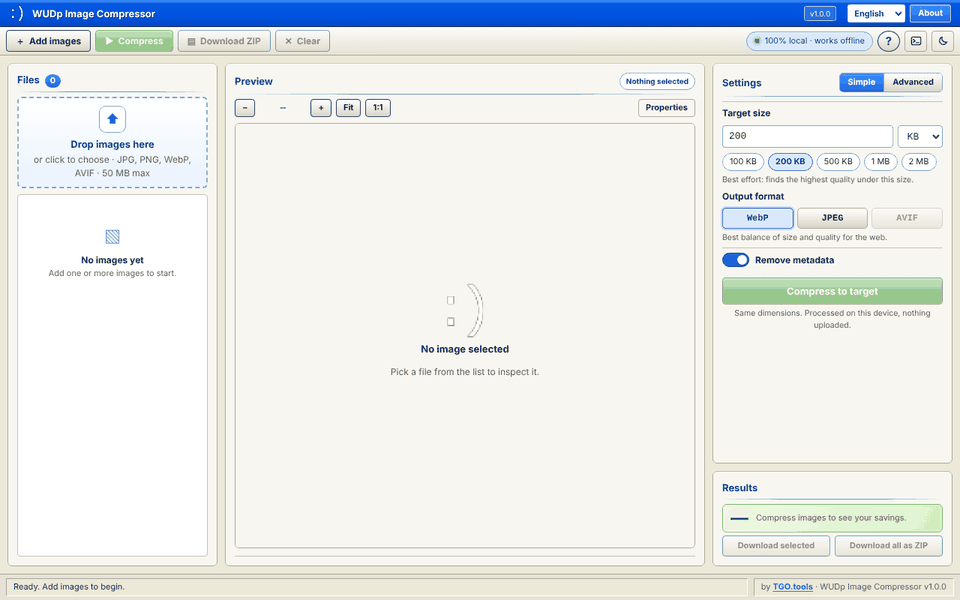
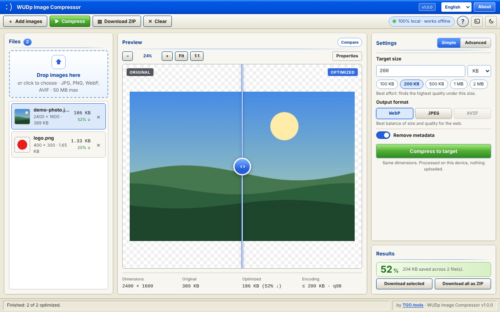
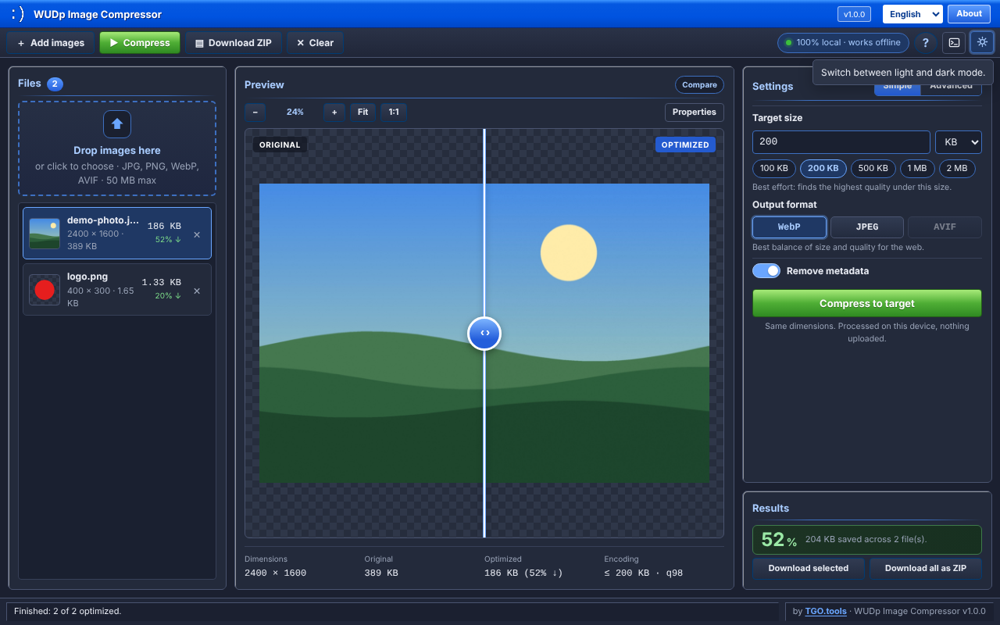
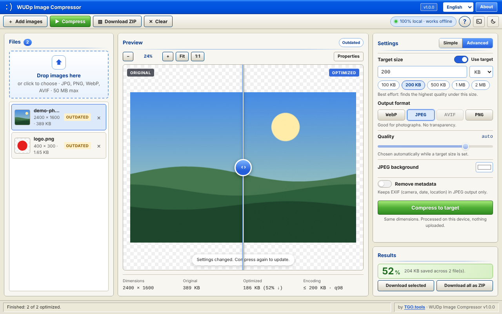
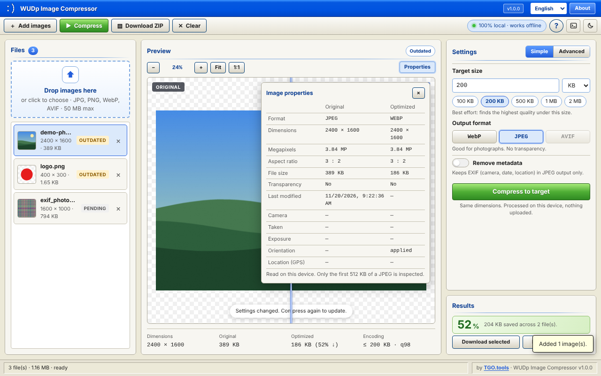
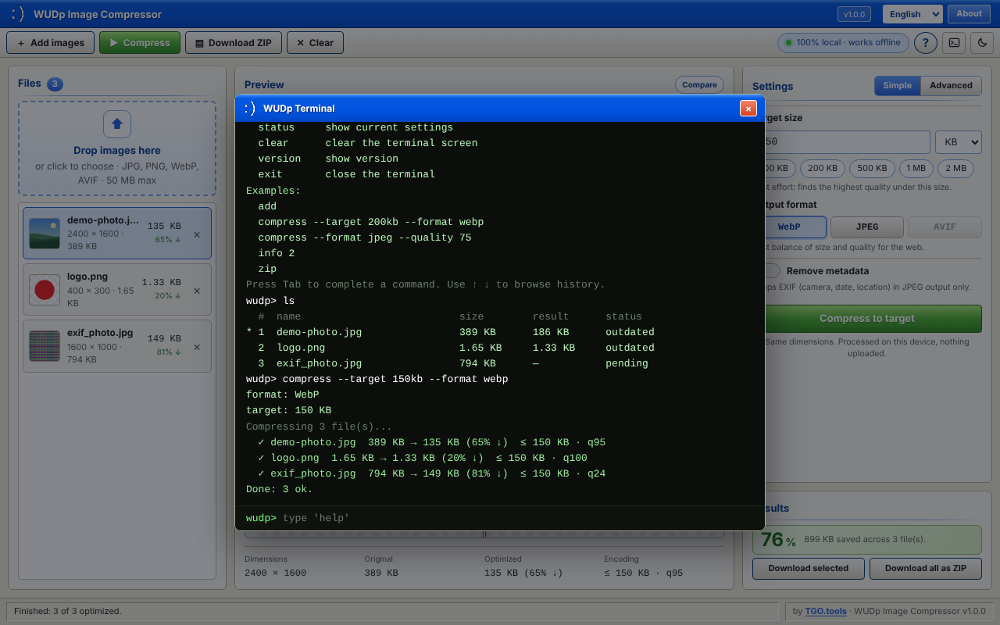
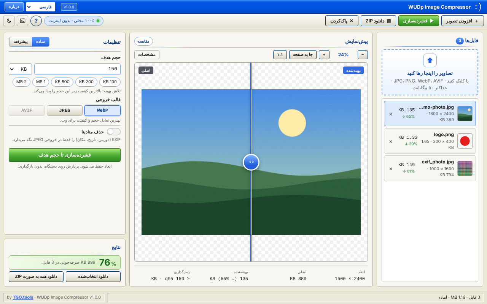
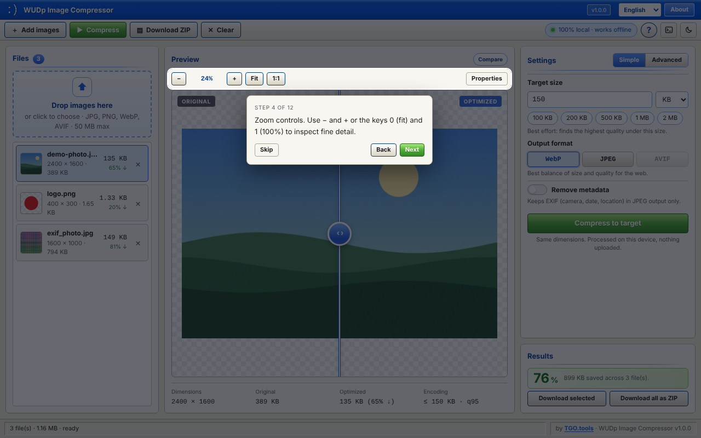
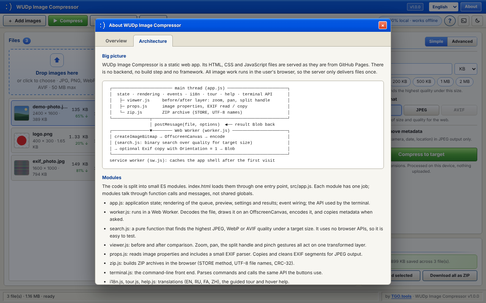

<div align="center">


### ▶ [Open the app online](https://wudp-tgotools.github.io/WUDp-image-compressor/)

No installation. Open the link, drop your images, and download the result.

# WUDp Image Compressor

**Compress images to an exact file size, entirely in your browser.**
Nothing is uploaded. Works offline. Free to use.


[Open the app](#-open-the-app-online) · [Features](#features) · [Quick start](#quick-start) · [Usage](#usage) · [Terminal](#terminal) · [Architecture](#architecture) · [Deploy](#deploy-on-github-pages) · [Changelog](#changelog)

</div>



---

## ▶ Open the app online

**[https://wudp-tgotools.github.io/WUDp-image-compressor/](https://wudp-tgotools.github.io/WUDp-image-compressor/)**

Works in any modern browser, on desktop and phone. After the first visit it also works offline.

## Why this exists

I built this for my office work. I often had to upload a photo that had to stay under a specific file size. The tools I found either sent my files to a server, or made me guess quality values until the size was right. I wanted something quick that runs on my own device, keeps the image private, and reaches a target size in one step.

## Features

- **Target size.** Enter a size (or pick a preset), and the app finds the highest quality that fits.
- **Formats.** WebP, JPEG, AVIF and PNG (lossless).
- **Simple and Advanced modes.** Simple asks only for a size. Advanced adds a quality slider, a target switch, PNG output and a JPEG background color.
- **Metadata control.** *Remove metadata* is on by default. Turn it off to keep camera, date and location data in JPEG output.
- **Before / after viewer.** Drag the handle to compare. Zoom with the wheel, pinch, buttons or keys. Pan by dragging.
- **Image properties.** Dimensions, transparency, file info and EXIF data. A warning appears when a photo contains a location.
- **Batch and ZIP.** Compress many files, then download one result or all of them as a ZIP.
- **Terminal.** Every action is also a command. Type `help` to see them.
- **Four languages.** English, Русский, فارسی (right-to-left) and 中文.
- **Guided tour and hover help.** Press *Tour* for a walkthrough, or hover over any control.
- **Dark mode.** Remembered on your device.
- **Private and offline.** No server, no uploads, no tracking. A service worker keeps the app available without a connection.

## Screenshots

| Main view | Dark mode |
| --- | --- |
|  |  |

| Advanced settings | Image properties |
| --- | --- |
|  |  |

| Terminal | Persian (RTL) |
| --- | --- |
|  |  |

| Guided tour | About → Architecture |
| --- | --- |
|  |  |

## Quick start

No installation or build step is needed. The app is static HTML, CSS and JavaScript.

**Option 1: use it online.** Open the [live app](https://wudp-tgotools.github.io/WUDp-image-compressor/).

**Option 2: run it on your computer.**

```bash
git clone https://github.com/WUDp-TGOtools/WUDp-image-compressor.git
cd WUDp-image-compressor
python -m http.server 8080      # or: npx serve .
```

Then open **http://localhost:8080**.

> Open the app through HTTP, not by double-clicking `index.html`. Browsers block ES modules and Web Workers on `file://` URLs.

## Usage

1. **Add images.** Click *Add images*, drop files onto the window, or paste from the clipboard.
2. **Choose a target.** In *Simple* mode, type a size (for example `200 KB`) or pick a preset.
3. **Choose a format.** WebP is the smallest for the web. JPEG suits photographs. PNG (Advanced) is lossless.
4. **Compress.** Press *Compress to target*. Results appear in the list and the *Results* panel.
5. **Compare.** Select a file and drag the handle over the preview. Zoom in to inspect details.
6. **Download.** Save one file with *Download selected*, or everything with *Download all as ZIP*.

### Metadata

By default, the output contains no metadata. Turn off *Remove metadata* to keep EXIF in **JPEG** output. Orientation is reset automatically so the photo is not rotated twice. WebP, AVIF and PNG outputs never contain metadata.

### Keyboard shortcuts

| Key | Action |
| --- | --- |
| `+` / `-` | Zoom in / out |
| `0` | Fit to view |
| `1` | Actual size (100%) |
| `←` / `→` | Move the comparison handle (hold `Shift` for larger steps) |
| `Ctrl` + `` ` `` | Open the terminal |
| `Esc` | Close a dialog or the tour |

## Terminal

Open the terminal with the `>_` button or `Ctrl` + `` ` ``. It runs the same operations as the interface. Use `Tab` to complete commands and `↑` / `↓` to browse history.

```text
add                                       open the file picker
ls                                        list files and their status
compress --target 200kb --format webp     compress with a target size
compress --format jpeg --quality 75       compress with a quality value
compress --keep-metadata --format jpeg    keep EXIF in JPEG output
info 2                                    show properties of file 2
metadata strip | metadata keep            set the metadata policy
format png | target off | mode advanced   change settings
stats | status | save 1 | zip             results and downloads
theme dark | version | help | exit        misc
```

## Architecture

The app's **About → Architecture** tab describes the same design in more detail, in all four languages.

```text
            ┌──────────────────────────── main thread ────────────────────────────┐
 files ───▶ │ app.js  ── state, rendering, events, i18n, tour, help               │
            │   │                                                                  │
            │   ├── viewer.js     one transformed layer: zoom, pan, split handle   │
            │   ├── props.js      EXIF reader and metadata helpers                 │
            │   └── terminal.js   commands → the same API as the buttons           │
            └───────────────┬──────────────────────────────────────────────────────┘
                            │ postMessage(file, options)
            ┌───────────────▼──────── Web Worker (worker.js) ──────────────────────┐
            │ createImageBitmap → canvas → encode (search.js for target size)      │
            │ → optional EXIF copy → Blob                                          │
            └───────────────┬──────────────────────────────────────────────────────┘
                            ▼
                 results ──▶ download  ·  zip.js (ZIP, UTF-8 names)
```

| File | Role |
| --- | --- |
| `index.html`, `src/app.js` | Single page; plain JavaScript state and rendering. No framework. |
| `src/worker.js`, `src/search.js` | Decoding and encoding off the UI thread. Target size uses a bounded binary search over quality (at most about 11 encodes). |
| `src/viewer.js` | Before and after share one transformed layer, so zoom, pan and the handle stay aligned. |
| `src/props.js` | EXIF reading. When metadata is kept, copies the APP1 segment into the JPEG and resets its orientation. |
| `src/zip.js` | Dependency-free ZIP writer (STORE) with UTF-8 names. |
| `src/terminal.js` | Command parser; delegates every action to the app API. |
| `src/i18n.js` | Translation dictionary (EN, RU, FA, ZH) and direction handling. |
| `src/tour.js`, `src/help.js` | Guided tour and hover/focus help. |
| `sw.js` | Service worker that caches the app shell for offline use. |

## Privacy

- All processing happens in your browser. Files are never sent anywhere.
- No analytics, cookies or external requests. Fonts are system fonts.
- The only stored values are the theme and language, kept in your browser's local storage.

## Limits

- Metadata is kept only in JPEG output.
- EXIF is read from the first 512 KB of a JPEG.
- A target size is a best effort. Some images cannot reach a very small target; the result says so.
- AVIF depends on browser support. Unsupported formats are disabled, not silently replaced.
- Maximum file size is 50 MB per image.

## Deploy on GitHub Pages

This repository is already set up for GitHub Pages:

1. In the repository, open **Settings → Pages**.
2. Under *Build and deployment*, choose **Deploy from a branch**, select `main` and the root folder `/`.
3. The site is published at **https://wudp-tgotools.github.io/WUDp-image-compressor/**.

All paths are relative, so the app also works under a sub-path. The `.nojekyll` file keeps GitHub from processing the files.

**Releasing a new version:** change the `CACHE` name in `sw.js` so browsers pick up the updated files.

## Browser support

Current Chrome, Edge, Firefox and Safari. AVIF encoding requires a browser that supports it; the app detects this and disables the option when it is missing.

## Source & references

- Project: [WUDp :) by TGO.tools](https://github.com/WUDp-TGOtools)
- Author: [TGO (The Giant Octopus)](https://github.com/TGO-root)
- Source code: [WUDp-TGOtools/WUDp-image-compressor](https://github.com/WUDp-TGOtools/WUDp-image-compressor)
- [MDN · OffscreenCanvas](https://developer.mozilla.org/docs/Web/API/OffscreenCanvas)
- [MDN · Web Workers API](https://developer.mozilla.org/docs/Web/API/Web_Workers_API)
- [PKWARE · ZIP File Format Specification](https://pkware.cachefly.net/webdocs/casestudies/APPNOTE.TXT)
- [CIPA DC-008 · Exif 2.32 specification](https://www.cipa.jp/std/documents/e/DC-008-Translation-2023-E.pdf)

## Contributing

Issues and suggestions are welcome. The project has no build step, so changes can be tested by serving the folder and reloading the page. Translations live in `src/i18n.js`; each key lists English, Russian, Persian and Chinese in that order.

## License

Not yet specified.

## Changelog

### 1.0.0 — first official release
- Renamed to WUDp Image Compressor.
- Target-size compression with Simple and Advanced modes; WebP, JPEG, AVIF and PNG output.
- Metadata option: removed by default, or kept in JPEG output.
- Before / after viewer with a draggable handle, zoom (wheel, pinch, buttons, keys) and pan.
- Image properties with EXIF reading and a location-data warning.
- Built-in terminal with commands for every option.
- Languages: English, Русский, فارسی (right-to-left), 中文.
- Guided tour, hover help, About dialog with architecture and sources.
- Dark mode, offline support, and a layout that fits the screen on common sizes.

---

<div align="center">

Made by **[TGO (The Giant Octopus)](https://github.com/TGO-root)** · part of **[WUDp :) by TGO.tools](https://github.com/WUDp-TGOtools)**

</div>
